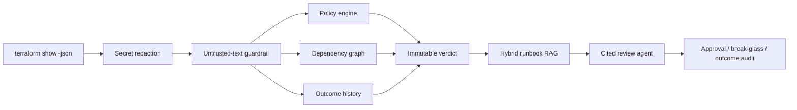

# OpsPreflight — Evidence-Driven IaC Review Agent

OpsPreflight is a production-shaped Terraform change reviewer that combines
**deterministic policy, blast-radius analysis, hybrid runbook RAG, agent
orchestration, prompt-injection defense and an auditable approval timeline**.

It turns Terraform plan JSON into an explainable `PASS / REVIEW / BLOCK`
decision and a cited review packet for developers and approvers. The LLM is
never the release authority: generated prose cannot change the deterministic
verdict.

## Architecture



This project demonstrates a practical AI-engineering pattern: deterministic
systems own safety-critical decisions, while RAG and an optional agent model
assemble evidence, remediation and audience-specific explanation.

## Implemented capabilities

- Terraform plan parsing, normalization and two-layer sensitive-data redaction.
- Eight named risk policies with `PASS / REVIEW / BLOCK` results.
- Dependency-graph blast radius and historical incident/rollback risk.
- Stable SHA-256 fingerprint and idempotent analysis identity.
- Hybrid runbook retrieval using BM25 plus dense vector similarity.
- Cited Agent Review packet with machine-readable tool trace.
- Prompt-injection scanning for untrusted IaC names, tags and descriptions.
- Hard invariants: AI output cannot alter the verdict or cite absent evidence.
- Human-in-the-loop approval and explicit Break-glass for BLOCK results.
- SQLite WAL audit timeline for analysis, approval and deployment outcome.
- FastAPI, CLI, Docker, GitHub Actions and two controlled evaluation suites.
- Optional OpenAI Agents SDK security/SRE specialist-handoff example.

## Policy set

| Rule | Evidence | Result |
|---|---|---|
| `NETWORK-001` | Public management/database port | BLOCK |
| `DATA-001` | Database becomes publicly accessible | BLOCK |
| `DATA-002` | Encryption at rest explicitly disabled | BLOCK |
| `IAM-001` | Allow statement with Action and Resource `*` | BLOCK |
| `CHANGE-002` | Production stateful delete/create replacement | BLOCK |
| `DATA-003` | Backup retention reduced | REVIEW |
| `RELIABILITY-001` | Production replicas reduced to 1 or 0 | REVIEW |
| `CONTEXT-001` | Resource has no registered owner | REVIEW |

## Quick start

```bash
python -m venv .venv
# Windows: .venv\Scripts\activate
# macOS/Linux: source .venv/bin/activate
python -m pip install -e ".[dev]"
python -m unittest discover -v
```

Create the traditional CI gate:

```bash
opspreflight analyze examples/risky-plan.json \
  --repository acme/platform \
  --commit abc123 \
  --environment production \
  --fail-on block
```

Create a grounded agent review:

```bash
opspreflight review examples/risky-plan.json \
  --repository acme/platform \
  --commit abc123 \
  --environment production \
  --audience approver
```

The review output includes the immutable analysis, required actions, open
questions, runbook citations, sparse/dense retrieval scores, injection findings
and each orchestration step.

Start the API:

```bash
uvicorn opspreflight.api:app --host 127.0.0.1 --port 8000
```

Open `http://127.0.0.1:8000/docs`, or use Docker:

```bash
docker compose up --build
```

## API surface

- `POST /v1/analyses` — deterministic plan analysis.
- `POST /v1/agent/reviews` — analysis plus grounded runbook review.
- `GET /v1/analyses/{id}` — retrieve immutable analysis.
- `POST /v1/analyses/{id}/approvals` — normal or Break-glass approval.
- `POST /v1/analyses/{id}/outcomes` — success/rollback/incident feedback.
- `POST /v1/analyses/{id}/brief` — deterministic audience brief.
- `GET /v1/analyses/{id}/timeline` — audit events.

Set `OPSPREFLIGHT_API_KEY` to require `X-API-Key`. This is a local demo
mechanism, not enterprise identity or RBAC.

## Reproducible evaluation

```bash
coverage run -m unittest discover -v
coverage report
python scripts/run_eval.py
python scripts/run_agent_eval.py
```

| Evaluation | Controlled result |
|---|---:|
| Automated tests | 59 passed |
| Branch coverage | 96% |
| Policy regression | 8 / 8 |
| Agent/RAG evaluation | 5 / 5 |
| Retrieval recall@3 | 100% |
| Verdict invariant rate | 100% |

Both datasets are controlled and synthetic. These figures are regression
evidence, not a claim of production detection accuracy. Real adoption requires
authorized replay of redacted plans and false-positive measurement.

## Optional live agent explanation

Install `.[ai]` and set `OPENAI_API_KEY`, then use
`examples/live_review_agent.py`. It hands the already-redacted evidence packet
to security and reliability specialists through the OpenAI Agents SDK. Sensitive
trace payloads are disabled. The local verdict remains authoritative even if the
model fails or returns misleading prose.

## Repository layout

```text
opspreflight/analyzer.py      Fingerprint, scoring and immutable verdict
opspreflight/policies.py      Eight deterministic release policies
opspreflight/parser.py        Terraform parsing and secret redaction
opspreflight/guardrails.py    Embedded prompt-injection inspection
opspreflight/retrieval.py     Hybrid runbook RAG
opspreflight/copilot.py       Evidence-first review-agent orchestration
opspreflight/storage.py       SQLite audit timeline and Break-glass
opspreflight/api.py           FastAPI endpoints
opspreflight/cli.py           CI gate and agent-review CLI
runbooks/catalog.json         Versioned operational knowledge base
scripts/                      Policy and agent evaluation suites
results/                      Committed reproducible evaluation artifacts
```

## Security model

1. Terraform sensitive masks and sensitive field names are redacted locally.
2. Free text inside IaC is untrusted and scanned before model-facing use.
3. Rules, graph and history create the immutable verdict.
4. Retrieval returns explicit source identifiers and scores.
5. Citation allow-listing and verdict equality are checked before response.
6. BLOCK needs an explicit, reasoned Break-glass event to proceed.

## Production boundary

Before serious use, add PostgreSQL and migrations, OIDC/GitHub App identity,
fine-grained RBAC, signed policy bundles, tenant-scoped runbook ACLs, real GitHub
Check Runs with webhook verification, OpenTelemetry export, durable queues,
backups, immutable external audit anchoring, post-deployment health verification
and authorized real-plan evaluation.

## Documentation

- [Architecture and trust boundary](docs/architecture.md)
- [Production-readiness boundary](docs/production-readiness.md)
- [Interview evidence and honest claims](docs/interview-evidence.md)
- [Resume wording and interview pitch](docs/resume-and-interview.md)

## Author

Liu Minghao — AI application and solution engineering portfolio
GitHub: [@lminghao233-tech](https://github.com/lminghao233-tech)

## License

MIT
