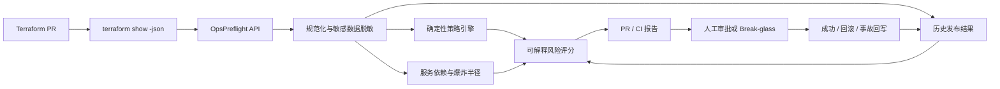

# OpsPreflight

> Evidence-driven infrastructure change risk and release approval service  
> 面向平台工程、SRE 与中小企业 IT 团队的基础设施变更风险门禁

OpsPreflight 在 Terraform 变更进入生产前，自动生成一份可以追责、可以复现、
可以阻断流水线的发布证据报告。它不是另一个聊天机器人：开发者无需主动提问，
系统会在每次 PR/发布中持续运行。

## 它解决什么问题

常见发布评审依赖人工浏览几百行 Terraform 输出，容易漏掉：

- 数据库被设为公网可访问；
- SSH、数据库或缓存端口向 `0.0.0.0/0` 开放；
- 加密被关闭、备份保存时间被缩短；
- 有状态资源被 Terraform 销毁重建；
- 一个数据库变更会影响哪些下游服务；
- 同类变更以前是否造成过回滚或事故；
- 高风险变更由谁批准、为什么批准、上线结果如何。

OpsPreflight 把这些信息合成一个 `PASS / REVIEW / BLOCK` 决策，并保留人工审批与
上线结果。历史事故会成为下一次相似变更的风险证据。

## 为什么 Codex 不能直接替代

Codex 可以帮助编写和解释 Terraform，但单次对话不承担以下产品职责：

1. 监听组织内每一次 PR 和发布；
2. 长期维护服务依赖图、负责人、历史事故和审批记录；
3. 用组织策略稳定地阻断 CI，而不是每次给出不同建议；
4. 验证调用者身份并保存审计证据；
5. 在发布后持续接收成功、回滚和事故结果；
6. 让模型生成的代码接受独立、确定性的安全检查。

因此这里的原则是：**确定性证据决定风险，AI 只能解释和补充上下文，不能删除或
降低安全发现。**

## 当前闭环



## 已实现能力

- Terraform Plan JSON 1.x 安全解析；
- Terraform `before_sensitive` / `after_sensitive` 与敏感字段名双重脱敏；
- 8 类确定性风险策略，并将上下文缺失作为独立复核证据；
- JSON 服务目录和多层下游爆炸半径；
- SQLite 持久化与幂等分析；
- 相似历史变更匹配，事故和回滚提高后续风险；
- `PASS / REVIEW / BLOCK` 与可解释分数组成；
- BLOCK 变更必须显式 Break-glass 才能批准；
- 分析、批准、覆盖和发布结果审计时间线；
- 可选 Responses API Evidence Briefing Agent，按开发者/审批人/管理者生成结构化说明；
- 未配置模型或 API 调用失败时自动回退确定性说明，决策闭环不受影响；
- FastAPI、API Key、CLI、Docker Compose 与 GitHub Actions 示例；
- 受控风险评测和自动化测试。

## 快速演示（Windows PowerShell）

### 终端 A：进入新项目并启动服务

```powershell
Set-Location "C:\Users\Lenovo\Documents\Codex\2026-08-16\gen\outputs\OpsPreflight"
uv sync
uv run opspreflight serve --host 127.0.0.1 --port 8000
```

### 终端 B：提交危险 Terraform Plan

```powershell
Set-Location "C:\Users\Lenovo\Documents\Codex\2026-08-16\gen\outputs\OpsPreflight"

uv run opspreflight analyze .\examples\risky-plan.json `
  --repository acme/platform `
  --commit abcdef1234567 `
  --pull-request 42 `
  --environment production `
  --output .\examples\demo-report.md `
  --fail-on block

$LASTEXITCODE
```

危险样例应该输出 `BLOCK (100/100)`，并返回退出码 `2`。这个非零退出码就是 CI
阻断发布的信号，不是程序异常。报告保存在 `examples/demo-report.md`。

### 查询 API

```powershell
Invoke-RestMethod -Uri "http://127.0.0.1:8000/v1/analyses"
```

API 文档：<http://127.0.0.1:8000/docs>

## 可选 AI Evidence Briefing Agent

先在 `.env` 配置：

```dotenv
OPSPREFLIGHT_OPENAI_API_KEY=replace-with-a-project-api-key
OPSPREFLIGHT_OPENAI_MODEL=gpt-5.4-mini
```

然后调用：

```powershell
$BriefRequest = @{
  audience = "approver"
  language = "zh-CN"
} | ConvertTo-Json

Invoke-RestMethod `
  -Method Post `
  -Uri "http://127.0.0.1:8000/v1/analyses/替换成分析ID/brief" `
  -ContentType "application/json" `
  -Body $BriefRequest
```

Agent 只接收脱敏证据摘要，并使用结构化输出；请求设置 `store=false`。模型生成的
`summary`、`required_actions` 和 `open_questions` 可以变化，但 `verdict`、分数和规则
来自本地分析对象，无法被模型改写。没有 API Key 时接口仍返回确定性说明。

## 风险分数不是大模型猜的

```text
final_score = policy_score + blast_radius_points + history_points
```

三项都可回溯：

- `policy_score`：最高确定性规则分；
- `blast_radius_points`：受影响服务和 Tier 0/1 服务数量；
- `history_points`：同仓库相似变更曾导致回滚或事故的加分。

存在强制阻断证据时直接 `BLOCK`。生产变更和归属未知的资源至少为 `REVIEW`。

## 当前策略

| Rule | 检查 | 默认结果 |
|---|---|---|
| `NETWORK-001` | 公网开放管理端口 | BLOCK |
| `DATA-001` | 数据库公网可访问 | BLOCK |
| `DATA-002` | 显式关闭静态加密 | BLOCK |
| `IAM-001` | IAM Action 与 Resource 双通配 | BLOCK |
| `CHANGE-002` | 生产有状态资源销毁重建 | BLOCK |
| `DATA-003` | 缩短备份保留时间 | REVIEW |
| `RELIABILITY-001` | 生产副本降至 1 或 0 | REVIEW |
| `CONTEXT-001` | 资源未登记负责人/服务 | REVIEW |

## GitHub Actions 接入

可直接参考 [`docs/github-actions-example.yml`](docs/github-actions-example.yml)。流水线生成
`tfplan.json` 后调用 CLI，报告写入 GitHub Job Summary，高风险变更返回退出码 2。

> Terraform Plan 可能包含敏感数据。不要把 `tfplan` 或 `tfplan.json` 提交到 Git；
> 本项目的 `.gitignore` 已默认排除它们。

## 测试与评测

```powershell
uv run ruff check .
uv run ruff format --check .
uv run pytest
uv run python .\scripts\run_eval.py
```

当前受控数据集是 8 个精心设计的回归案例，目标是防止策略回退，不代表真实企业
环境准确率。下一步应从脱敏的真实 PR、误报和事故结果扩充数据集。

## 文档

- [一页项目总览](docs/project-summary.md)
- [系统架构](docs/architecture.md)
- [商业价值与目标客户](docs/product-and-commercialization.md)
- [生产就绪边界](docs/production-readiness.md)
- [5 分钟演示指南](docs/demo-guide.md)
- [面试问题与回答](docs/interview-qa.md)
- [简历项目经历](docs/resume-project.md)
- [GitHub 发布检查单](docs/github-publishing-checklist.md)
- [安全策略](SECURITY.md)

参与开发请先阅读 [CONTRIBUTING.md](CONTRIBUTING.md)。

## 项目状态

`0.1.0` 是可以本机或单节点部署的垂直 MVP，不等于大型企业生产就绪。当前使用
SQLite 和共享 API Key；多实例、OIDC、PostgreSQL、真实 GitHub App、OPA 策略包、
发布后指标自动验证仍在路线图中。当前环境没有 OpenAI API Key，因此模型路径使用
伪客户端完成自动化测试，没有声称做过真实线上模型调用。
